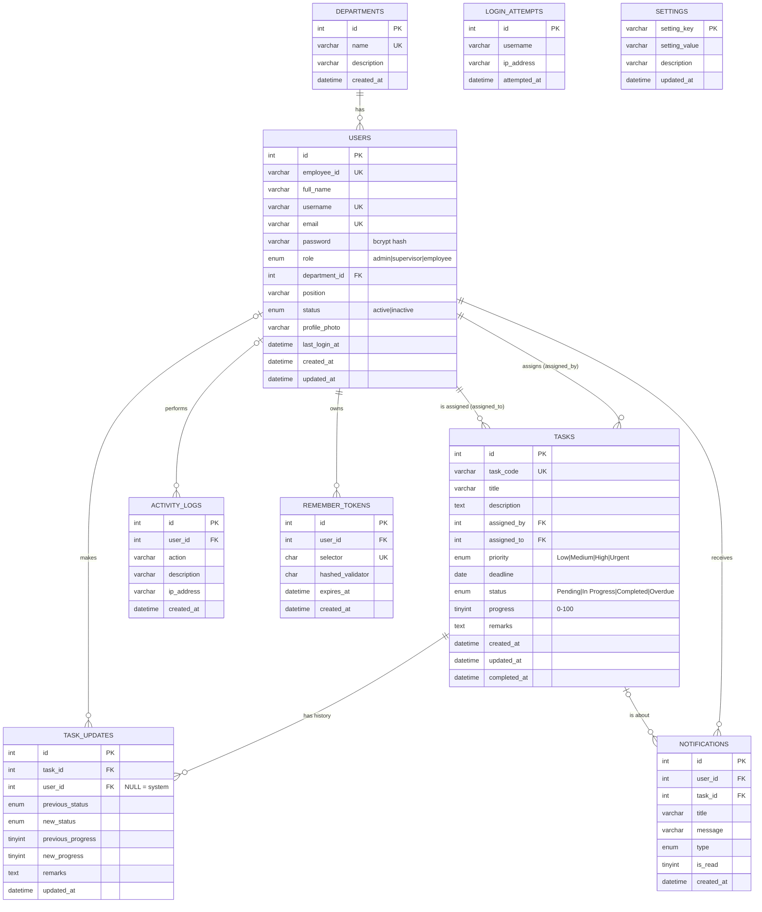

# EODB-TaskFlow — Phase 1: System Architecture, Database, and ERD

**EODB-TaskFlow: A Web-Based Streamlined Employee Task and Productivity Monitoring System in RHU Mulanay**

---

## 1. System Architecture

EODB-TaskFlow follows a **three-tier client–server architecture** that runs on a local XAMPP server.

```
┌──────────────────────────────┐
│  PRESENTATION TIER (Client)  │  Web browser on an office PC, laptop, tablet, or phone
│  HTML5 · CSS3 · Bootstrap 5  │  Responsive pages, forms, tables, charts
│  JavaScript · Font Awesome   │
└──────────────┬───────────────┘
               │ HTTP request (GET / POST + CSRF token + session cookie)
               ▼
┌──────────────────────────────┐
│  APPLICATION TIER (Server)   │  Apache + PHP 8 (XAMPP)
│  includes/auth.php           │  Authentication, sessions, role checks
│  includes/functions.php      │  Validation, escaping, task status, productivity
│  admin/ supervisor/ employee/│  Role-specific pages (business logic)
│  reports/ notifications/     │  Reports, exports, notifications
└──────────────┬───────────────┘
               │ PDO prepared statements only
               ▼
┌──────────────────────────────┐
│  DATA TIER                   │  MySQL / MariaDB database "eodb_taskflow"
│  9 tables + 1 view           │  Foreign keys, indexes, CHECK constraints
└──────────────────────────────┘
```

### Request flow (every protected page)

1. The browser requests a page, e.g. `/eodb-taskflow/supervisor/tasks.php`.
2. The page loads `config/app.php`, `config/database.php`, and `includes/auth.php`.
3. `auth.php` checks for a valid session (and session timeout). If there is none, it redirects to `login.php`.
4. `require_role('supervisor')` checks the user's role. If the role is wrong, the server returns **403 Unauthorized**, so an employee can never open admin or supervisor pages, even by typing the URL.
5. The page runs **overdue detection** (Algorithm 3), queries the database with prepared statements, and renders HTML with every value escaped (`htmlspecialchars`).
6. Every POST form carries a **CSRF token** that is validated before any data changes.

---

## 2. IPO Conceptual Framework → System Features

| IPO Element | Implemented by |
|---|---|
| **INPUT** Employee information, user account, role | `users` + `departments` tables; Admin › Add/Edit User |
| Task information, description, priority, deadline | `tasks` table; Supervisor › Create/Edit Task |
| Task status, progress, employee remarks | `tasks.status`, `tasks.progress`, `tasks.remarks`; Employee › Update Task |
| System requirements | `settings` table; Admin › Settings |
| **PROCESS** User authentication | `login.php`, `includes/auth.php`, `password_verify()`, `login_attempts`, `remember_tokens` |
| Task creation / assignment / recording | `supervisor/create_task.php` → `tasks` + `task_updates` + `notifications` + `activity_logs` |
| Task updating, status and progress monitoring | `employee/update_task.php` → `task_updates` history |
| Deadline monitoring, overdue detection | `refresh_overdue_tasks()` (Algorithm 3), `deadline_upcoming` notifications |
| Accomplishment recording | `tasks.completed_at`, `task_updates` rows with `new_status = 'Completed'` |
| Searching and filtering | Indexed `WHERE` filters on status, priority, employee, department, date range |
| Productivity computation | `vw_employee_productivity` view (Algorithm 4) |
| Report generation | `reports/` pages: print, CSV export |
| Data storage | MySQL InnoDB tables with foreign keys |
| **OUTPUT** Organized task records; updated status; progress | Task Monitoring table, Task Details with progress bar and history |
| Completed / Pending / Overdue records | Status filters and dashboard counters |
| Employee productivity summary | Productivity table and charts |
| Task monitoring reports | Task Report, Productivity Report, Accomplishment Report (printable) |

---

## 3. User Roles and Access Matrix

| Module / Action | Admin | Supervisor | Employee |
|---|:---:|:---:|:---:|
| Dashboard (role-specific) | ✔ | ✔ | ✔ |
| Manage users / employees (add, edit, deactivate, change role) | ✔ | — | — |
| View employee list and performance | ✔ | ✔ | — |
| View all tasks | ✔ | ✔ | — |
| Create / assign / edit / delete task | — | ✔ | — |
| Review task accomplishments | — | ✔ | — |
| View own assigned tasks | — | — | ✔ |
| Update status, progress, remarks; mark completed | — | — | ✔ (own tasks only) |
| Own task history and productivity | — | — | ✔ |
| Reports (task, productivity, accomplishment) | ✔ | ✔ | — |
| Activity logs | ✔ | — | — |
| System settings | ✔ | — | — |
| Notifications | ✔ | ✔ | ✔ |
| Own profile | ✔ | ✔ | ✔ |

Enforcement happens on the **server** (`require_role()` on every page plus ownership checks in queries such as `WHERE id = ? AND assigned_to = ?`). Hiding sidebar links is only for convenience, not for security.

---

## 4. Entity Relationship Diagram (ERD)

### 4.1 Diagram (Mermaid — renders on GitHub, in VS Code with a Mermaid extension, or at mermaid.live)



### 4.2 Relationships

All relationships are **one-to-many (1:N)**.

| Parent (one) | Child (many) | Foreign key | Meaning | On delete |
|---|---|---|---|---|
| departments | users | `users.department_id` | One department has many users | SET NULL |
| users | tasks | `tasks.assigned_by` | One supervisor assigns many tasks | RESTRICT |
| users | tasks | `tasks.assigned_to` | One employee is assigned many tasks | RESTRICT |
| tasks | task_updates | `task_updates.task_id` | One task has many history entries | CASCADE |
| users | task_updates | `task_updates.user_id` | One user makes many updates (NULL = system) | SET NULL |
| users | notifications | `notifications.user_id` | One user receives many notifications | CASCADE |
| tasks | notifications | `notifications.task_id` | One task triggers many notifications | SET NULL |
| users | activity_logs | `activity_logs.user_id` | One user performs many logged actions | SET NULL |
| users | remember_tokens | `remember_tokens.user_id` | One user may stay logged in on many devices | CASCADE |

**USERS → TASKS is a double relationship.** The same `users` table is referenced twice: once as the *assigner* (supervisor) and once as the *assignee* (employee). This avoids separate supervisor and employee tables, which would duplicate the same columns.

**Why RESTRICT on tasks:** a user who has tasks cannot be physically deleted. User accounts are **deactivated** (`status = 'inactive'`) instead, so reports and task history are never broken.

### 4.3 Keys

- **Primary keys (PK):** every table has a surrogate `id` (`INT UNSIGNED AUTO_INCREMENT`), except `settings`, which uses its natural key `setting_key`.
- **Foreign keys (FK):** listed in 4.2. They are enforced by InnoDB, so the database itself rejects, for example, a task assigned to a user ID that does not exist.
- **Unique keys (UK):** `users.employee_id`, `users.username`, `users.email`, `tasks.task_code`, `departments.name`, `remember_tokens.selector`.
- **Indexes:** placed on columns used for searching, filtering, joining, and sorting (`status`, `priority`, `deadline`, `assigned_to + status`, `created_at`, `completed_at`, `user_id + is_read`, etc.).
- **CHECK constraints:** `progress BETWEEN 0 AND 100` on `tasks` and `task_updates`.

### 4.4 Normalization

- **1NF:** every column holds a single atomic value; there are no repeating groups. Task history is stored as rows in `task_updates`, not as a list inside `tasks`.
- **2NF:** every table has a single-column primary key, so there are no partial dependencies.
- **3NF:** department details live in `departments` and are referenced by `department_id`, so they are not repeated per user. Employee names are not stored in `tasks`; they are joined from `users`.
- **Deliberate derived value:** `tasks.status` can be computed from `progress` and `deadline`, but it is stored so that it can be indexed for fast filtering and recorded in history. Algorithm 3 is the single function that keeps it consistent.

---

## 5. Data Dictionary

### departments
| Column | Type | Null | Key | Description |
|---|---|---|---|---|
| id | INT UNSIGNED | No | PK | Auto-increment ID |
| name | VARCHAR(100) | No | UK | Department/unit name |
| description | VARCHAR(255) | Yes | | Short description |
| created_at | DATETIME | No | | Date created |

### users
| Column | Type | Null | Key | Description |
|---|---|---|---|---|
| id | INT UNSIGNED | No | PK | Auto-increment ID |
| employee_id | VARCHAR(20) | No | UK | Office employee number (e.g. RHU-EMP-001) |
| full_name | VARCHAR(150) | No | IDX | Full name |
| username | VARCHAR(50) | No | UK | Login username |
| email | VARCHAR(150) | No | UK | Email (can also be used to log in) |
| password | VARCHAR(255) | No | | bcrypt hash from `password_hash()` |
| role | ENUM | No | IDX | admin, supervisor, employee |
| department_id | INT UNSIGNED | Yes | FK | → departments.id |
| position | VARCHAR(100) | Yes | | Job position |
| status | ENUM | No | IDX | active, inactive |
| profile_photo | VARCHAR(255) | Yes | | File name in `assets/images/profiles/` |
| last_login_at | DATETIME | Yes | | Last successful login |
| created_at / updated_at | DATETIME | No | | Timestamps |

### tasks
| Column | Type | Null | Key | Description |
|---|---|---|---|---|
| id | INT UNSIGNED | No | PK | Auto-increment ID |
| task_code | VARCHAR(20) | No | UK | Generated code `TASK-YYYY-NNNN` |
| title | VARCHAR(200) | No | | Task title |
| description | TEXT | Yes | | Details |
| assigned_by | INT UNSIGNED | No | FK | → users.id (supervisor) |
| assigned_to | INT UNSIGNED | No | FK | → users.id (employee) |
| priority | ENUM | No | IDX | Low, Medium, High, Urgent |
| deadline | DATE | No | IDX | Due date |
| status | ENUM | No | IDX | Pending, In Progress, Completed, Overdue |
| progress | TINYINT UNSIGNED | No | CHECK | 0–100 |
| remarks | TEXT | Yes | | Latest remarks |
| created_at / updated_at | DATETIME | No | IDX | Timestamps |
| completed_at | DATETIME | Yes | IDX | Set when progress reaches 100% |

### task_updates
| Column | Type | Null | Key | Description |
|---|---|---|---|---|
| id | INT UNSIGNED | No | PK | |
| task_id | INT UNSIGNED | No | FK | → tasks.id |
| user_id | INT UNSIGNED | Yes | FK | → users.id; NULL = automatic system change |
| previous_status | ENUM | Yes | | NULL when the task is first created |
| new_status | ENUM | No | | Status after the change |
| previous_progress | TINYINT UNSIGNED | Yes | | NULL when the task is first created |
| new_progress | TINYINT UNSIGNED | No | | Progress after the change |
| remarks | TEXT | Yes | | Remarks entered with the update |
| updated_at | DATETIME | No | IDX | When the change happened |

### notifications
| Column | Type | Null | Key | Description |
|---|---|---|---|---|
| id | INT UNSIGNED | No | PK | |
| user_id | INT UNSIGNED | No | FK | Recipient → users.id |
| task_id | INT UNSIGNED | Yes | FK | Related task → tasks.id |
| title | VARCHAR(150) | No | | Short title |
| message | VARCHAR(500) | No | | Message text |
| type | ENUM | No | IDX | task_assigned, deadline_upcoming, task_overdue, task_completed, task_updated, system |
| is_read | TINYINT(1) | No | IDX | 0 = unread, 1 = read |
| created_at | DATETIME | No | | |

### activity_logs
| Column | Type | Null | Key | Description |
|---|---|---|---|---|
| id | INT UNSIGNED | No | PK | |
| user_id | INT UNSIGNED | Yes | FK | Actor → users.id; NULL = system |
| action | VARCHAR(50) | No | IDX | login, login_failed, logout, create_task, assign_task, update_task, complete_task, delete_task, add_user, edit_user, deactivate_user, unauthorized_access, security, system, … |
| description | VARCHAR(500) | No | | Human-readable details |
| ip_address | VARCHAR(45) | Yes | | Client IP (IPv4/IPv6) |
| created_at | DATETIME | No | IDX | Date and time |

### remember_tokens, login_attempts, settings
Supporting security and configuration tables. See the comments in `database/eodb_taskflow.sql`.

### vw_employee_productivity (view)
Per employee: `total_tasks`, `completed_tasks`, `pending_tasks`, `in_progress_tasks`, `overdue_tasks`, `completion_rate` = Completed ÷ Total × 100 (0 when there are no tasks).

---

## 6. Changes and Additions to the Proposed Schema

| Change | Reason |
|---|---|
| `users.department` (text) → **`users.department_id`** (FK to the new **`departments`** table) | Normalization (3NF): consistent department names for the department filter and reports, with no spelling variations. |
| Added `users.last_login_at` | Shown on user management; useful for auditing. |
| `task_updates.user_id` is **nullable** | Overdue status changes are made automatically by the system, not by a person. |
| Added `activity_logs.ip_address` | Standard audit information for the security requirements. |
| New table **`remember_tokens`** | Lets "Remember me" be implemented securely (selector plus hashed validator), as the requirement asked. |
| New table **`login_attempts`** | Brute-force protection: temporary lockout after repeated failed logins. |
| New table **`settings`** | Supports the Admin's "Manage system settings" permission. |
| New view **`vw_employee_productivity`** | One shared implementation of Algorithm 4 for dashboards and reports. |
| `tasks.deadline` uses type **DATE** | Office deadlines are day-based. A task becomes overdue the day after its deadline (`CURDATE() > deadline`). |

All other table and column names are exactly as specified.

---

## 7. Algorithm Placement (implemented in later phases)

| Algorithm | Location | Phase |
|---|---|---|
| 1 – Login Authentication | `login.php`, `includes/auth.php` | 2 |
| 2 – Task Assignment | `supervisor/create_task.php`, `generate_task_code()` | 4 |
| 3 – Task Status | `compute_task_status()` and `refresh_overdue_tasks()` in `includes/functions.php` | 5–6 |
| 4 – Productivity Rate | `vw_employee_productivity` + `completion_rate()` | 3–8 |
| 5 – Notification | `create_notification()`, `generate_deadline_notifications()` | 4–7 |

**Algorithm 3 (as it will be coded):**
```
IF progress = 100            THEN status = Completed
ELSE IF today > deadline     THEN status = Overdue      (progress is kept)
ELSE IF progress > 0         THEN status = In Progress
ELSE                              status = Pending
```

---

## 8. Final Folder Structure (planned)

✔ = created in Phase 1. Other files are created in the phase shown.

```
eodb-taskflow/
├── index.php                      (P2) redirects to the correct dashboard
├── login.php                      (P2)
├── logout.php                     (P2)
├── unauthorized.php               (P2) 403 page
├── .htaccess                      (P10) security headers, no directory listing
├── README.md                      ✔ (completed in P10)
├── config/
│   ├── app.php                    ✔ constants, timezone, error settings
│   ├── database.php               ✔ PDO connection db()
│   └── .htaccess                  ✔ deny web access
├── includes/
│   ├── auth.php                   (P2) sessions, require_login(), require_role()
│   ├── csrf.php                   (P2) CSRF token helpers
│   ├── functions.php              (P2+) escaping, validation, flash messages, logging
│   ├── task_functions.php         (P4–6) task code, status algorithm, overdue detection
│   ├── notification_functions.php (P7)
│   ├── header.php                 (P3)
│   ├── navbar.php                 (P3)
│   ├── sidebar.php                (P3) role-based menu
│   └── footer.php                 (P3)
├── admin/
│   ├── dashboard.php  users.php  add_user.php  edit_user.php  view_user.php   (P3)
│   ├── tasks.php                  (P6) view all tasks
│   ├── reports.php                (P8)
│   ├── activity_logs.php          (P7)
│   └── settings.php               (P7)
├── supervisor/
│   ├── dashboard.php  tasks.php  create_task.php  edit_task.php                (P4)
│   ├── task_details.php  delete_task.php                                       (P4/P6)
│   ├── employees.php              (P6) employee performance
│   └── reports.php                (P8)
├── employee/
│   ├── dashboard.php  my_tasks.php  task_details.php  update_task.php          (P5)
│   └── history.php                (P5) task history
├── profile/
│   └── index.php                  (P5) shared by all roles (see note)
├── notifications/
│   ├── index.php                  (P7)
│   ├── mark_read.php              (P7)
│   └── fetch.php                  (P7) navbar dropdown data
├── reports/
│   ├── task_report.php            (P8)
│   ├── productivity_report.php    (P8)
│   ├── accomplishment_report.php  (P8)
│   ├── print_report.php           (P8) printable layout with signature lines
│   └── export_csv.php             (P8)
├── assets/
│   ├── css/  style.css  print.css (P3/P8)
│   ├── js/   app.js  charts.js    (P3/P6)
│   └── images/ logo, profiles/    (P3/P5)
├── database/
│   ├── eodb_taskflow.sql          ✔
│   ├── setup.php                  ✔ one-time password hashing and verification
│   └── .htaccess                  ✔ blocks .sql downloads
└── docs/
    ├── PHASE1_SYSTEM_DESIGN.md    ✔ this document
    └── TESTING_CHECKLIST.md       (P10)
```

**Note on the structure:** `employee/profile.php` from the proposal becomes **`profile/index.php`**, because the sidebar shows *Profile* to all three roles. A single shared page avoids three copies of the same code. Additional helper files (`csrf.php`, `task_functions.php`, `export_csv.php`, and others) were added to keep each file focused.

---

## 9. How to Test Phase 1

1. Copy the `eodb-taskflow` folder to `C:\xampp\htdocs\eodb-taskflow`.
2. Start **Apache** and **MySQL** in the XAMPP Control Panel.
3. Open `http://localhost/phpmyadmin` → **Import** → choose `database/eodb_taskflow.sql` → **Import**.
   (The script creates the `eodb_taskflow` database itself.)
4. Open `http://localhost/eodb-taskflow/database/setup.php`. Every line should show `[ OK ]`.
5. In phpMyAdmin, run the verification queries below (SQL tab, database `eodb_taskflow`).

```sql
-- a) Passwords are hashed (should start with $2y$, length 60)
SELECT username, LEFT(password, 7) AS hash_prefix, CHAR_LENGTH(password) AS len FROM users;

-- b) Task monitoring view with joins
SELECT t.task_code, t.title, e.full_name AS employee, s.full_name AS assigned_by,
       t.priority, t.deadline, t.status, t.progress
FROM tasks t
JOIN users e ON e.id = t.assigned_to
JOIN users s ON s.id = t.assigned_by
ORDER BY t.deadline;

-- c) Productivity (Algorithm 4)
SELECT * FROM vw_employee_productivity;

-- d) Overdue rule check (Algorithm 3): should return the 2 overdue sample tasks
SELECT task_code, deadline, progress, status FROM tasks
WHERE deadline < CURDATE() AND progress < 100;

-- e) Task history
SELECT * FROM task_updates WHERE task_id = 3 ORDER BY updated_at;
```

6. **Constraint tests.** Each of these must FAIL with an error. That proves the database protects its own integrity.

```sql
-- Foreign key: assigning a task to a user who does not exist
INSERT INTO tasks (task_code, title, assigned_by, assigned_to, deadline)
VALUES ('TASK-TEST-0001', 'Test', 2, 999, CURDATE());

-- RESTRICT: deleting an employee who has tasks
DELETE FROM users WHERE id = 3;

-- CHECK: progress over 100
UPDATE tasks SET progress = 150 WHERE id = 6;

-- UNIQUE: duplicate username
INSERT INTO users (employee_id, full_name, username, email, password)
VALUES ('RHU-X-1', 'Dup', 'admin', 'dup@test.local', 'x');
```

7. **Cascade test** (optional; re-import the SQL afterwards to restore the sample data):
```sql
DELETE FROM tasks WHERE id = 12;                       -- its task_updates rows are removed
SELECT COUNT(*) FROM task_updates WHERE task_id = 12;  -- 0
SELECT task_id FROM notifications WHERE message LIKE '%TASK-2026-0012%';  -- task_id is now NULL
```

**Expected sample productivity:** Juan M. Dela Cruz 25.00%, Ana P. Reyes 50.00%, Mark Anthony L. Garcia 0.00%, Kristine Joy B. Ramos 50.00%, Rogelio T. Bautista 50.00%, Liza M. Fernandez 0.00% (inactive, no tasks).
